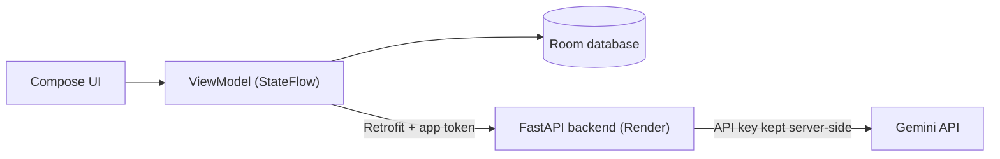

# SpendSense

An Android expense tracker with two AI features: **scan a bill** (photo or PDF) to fill in an expense automatically, and **ask questions about your spending** in plain language.

> Built to learn modern Android development end to end: Jetpack Compose UI, a local database, a small deployed backend, and generative AI used responsibly.

*Screenshots and a demo video are coming soon.*

## Features

- Add, edit and delete expenses, stored on the device (works offline)
- Monthly summary with per-category bars and a month switcher
- **Scan a bill:** pick a photo or PDF, the AI extracts merchant, amount, date and category, and you review it before saving
- **Ask your spending:** questions like "How much did I spend on food this month?" answered from your own data
## Architecture



- **UI:** Jetpack Compose, Material 3, Navigation Compose
- **State:** MVVM with `ViewModel` and `StateFlow`; the summary is derived from the expense list rather than stored
- **Storage:** Room (SQLite), with a `LocalDate` type converter
- **Networking:** Retrofit and OkHttp, with timeouts sized for slow AI calls
- **Backend:** a small FastAPI service that holds the Gemini API key, so the key never ships inside the APK
## Design decisions

- **API key on a server, not in the app.** Anything inside an APK can be extracted. The app calls my backend, and only the backend holds the Gemini key.
- **AI output prefills the form, it never saves directly.** The model can be wrong, so the user is the final check.
- **Grounded answers.** The chat sends the user's expenses with each question, and the prompt tells the model to answer only from that data and to treat expense text as data, never as instructions.
- **Structured output.** Bill scanning asks the model for JSON matching a schema, so the app parses a reliable shape rather than free text.
- **Failure handling.** Network errors, bad files and quota limits each lead to a clear message instead of a crash. Quota errors (HTTP 429) are not retried, since they will not clear in seconds.
## Limitations (honest notes)

- **LLM arithmetic can be wrong.** The chat's totals come from the model reading a list. They are usually right, but the Summary tab is the source of truth. A stronger design would let the model request a calculation that the app runs itself (tool calling).
- **Free-tier AI quota is small** (about 20 requests per day on the free Gemini tier when I built this), so heavy use will hit a limit.
- **Cold starts.** The backend runs on a free Render instance that sleeps when idle, so the first request after a pause can take up to a minute.
- **The app token is a speed bump, not strong security.** A token inside an APK can be extracted. It stops casual abuse, together with server-side rate limiting. Production-grade protection would use Firebase App Check or Play Integrity.
- **No SMS reading.** I chose not to read bank SMS, because Google Play restricts the SMS permissions for this kind of app.
## Privacy

Scanned bills and the expenses used in chat questions are sent to my backend and then to the Gemini API to produce a result. The backend does not store them. Nothing is sent unless you use the scan or chat features, and the app says so on the chat screen.

## Tech stack

Kotlin · Jetpack Compose · Room · Navigation Compose · Retrofit/OkHttp · Coroutines & Flow · FastAPI (Python) · Gemini API · Render

## Run it yourself

1. Clone this repo and open it in Android Studio.
2. Deploy or run the backend: [spendsense-backend](https://github.com/narine01/spendsense-backend)
3. Generate your own random token (for example `python3 -c "import secrets; print(secrets.token_urlsafe(32))"`). Set it as `APP_TOKEN` in your backend's environment, and put the same value in the app's `local.properties` (git-ignored): `APP_TOKEN=<your own token>`. Never commit a real token.
4. Set `BASE_URL` in `Backend.kt` to your backend's URL.
5. Run the app.
## Tests

```
./gradlew test
```

Unit tests cover the monthly summary logic: empty data, month filtering, grouping and sums, ordering, month boundaries, and the same month in different years.

## What I would add next

- CameraX capture inside the app
- Streaming chat responses
- Tool calling so totals are computed by the app, not the model
- Firebase App Check
- Export to CSV
## Author

**Laxmy Narayan** · [LinkedIn](https://linkedin.com/in/laxmy-narayan)
 